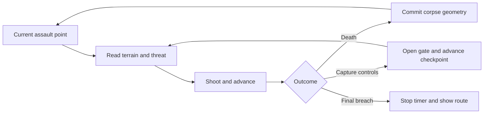

# Meat Shield game design

This is the proposed implementation baseline. Requirement IDs and verification links are maintained in [requirements](../../planning/requirements.json); initial numbers are maintained in [tuning](../../planning/tuning.example.json). Numbers are prototype hypotheses until playtested.

## Core loop

Observe the next defensive angle, suppress it, move toward a useful position, and either breach the objective or leave a useful body. Respawn at the current assault point and immediately exploit the altered terrain. Capturing the next point advances the spawn, opens a gate, and permanently disables the sector's principal threat.

The world remains loaded across deaths. Only the controlled pawn is replaced. Defenders and objective timers continue. There is no menu death screen, per-life score, resource fee, or life limit. The accepted prototype now uses a short [ragdoll pull-back/return camera](persistent-deaths.md) before first-person control resumes.

## Movement and placement

The movement set is walk, sprint, crouch, jump, short dive, and contextual low vault. Sprint and dive primarily control reach and corpse placement. There is no double jump, air dash, grappling hook, or corpse placement editor. Looking and aiming remain available during ordinary movement; vault and dive have short authored control restrictions tested for comfort.

The player is approximately 1.8 m tall standing and 1.05 m crouched. Start with a 0.45 m step and a 0.9 m contextual vault. A ledge used to teach added height must remain above unaided reach and become reachable after one to three useful placements. Blockout dimensions must be tuned against actual movement, not assumed from the model's height.

At lethal damage, sample location, velocity, stance, and movement action. Use a bounded forward sweep to choose a supported final body pose near the death location. Dive momentum influences the reachable anchor; the algorithm must not move a corpse through a wall, across an unsupported gap, or farther than the configured placement sweep. The same inputs should produce a result within the placement tolerance in repeated trials. Random gore and impact effects cannot alter the gameplay result.

## Corpse construction rules

1. A successful placement commits stable collision immediately during the death transaction. A short cosmetic impact and settling effect can continue after control returns at spawn.
2. A settled construction body supports the player and blocks ordinary rifle and emplacement fire. Cover also blocks the emplacement's line of sight. All baseline bullets are nonpenetrating.
3. Later footsteps, bullets, and ragdolls cannot push settled construction. New bodies can build on supported existing bodies within the construction height limit.
4. New geometry requires support beneath its footprint. No floating platforms, arbitrary snapping to distant surfaces, or unsupported bridges are generated. A crossing is made by filling a shallow existing interruption from below.
5. Coverage and height are locally bounded. A full tile gives no further construction advantage; additional deaths there produce only a brief effect aligned with existing material. Useful existing collision never disappears because a visual pool or corpse count is full.
6. Spawn safety zones, kill volumes, and inaccessible out-of-bounds ground do not accept construction. All playable assault routes must have authored construction coverage.
7. The visible silhouette must match the useful collision closely enough to predict shelter and footing. Reduced-gore mode preserves that silhouette.
8. Mistakes remain recoverable through generous vaulting and a sector reset. Manual dragging and shoving are deferred.

Bodies are material, not inventory. There is no pickup, construction menu, body currency, score multiplier, or reward for producing many corpses. The physical system must make a precise placement more useful than repeatedly dying in a full patch near spawn.

## Death and respawn transaction

The lethal hit is accepted once per life. In the same simulation update, commit the new construction body if valid, increment the deployment count, preserve weapon and world state, and request the next pawn at the captured spawn. The next pawn starts healthy, facing the active approach, with the same magazine, reserve ammunition, and reload progress. Clear stale held fire and interact commands; require a new press for interaction. Movement held across death may resume after possession to preserve flow.

The current user-directed prototype targets death-to-controllable time of at most 1.2 s, including its 1.05 s ragdoll observation/return sequence. This supersedes the earlier 150 ms target. This is measured from lethal damage to the first simulation update that accepts movement on the replacement pawn. It includes any safety relocation and possession. It excludes initial level loading and does not promise display or device latency. In this slice, ragdoll physics commits a fixed pose at 0.75 s before control returns. The earlier immediate authored proxy is a future constrained-placement proposal, as recorded in ADR 0006.

Spawn anchors have authored backup positions. Newly spawned pawns cannot create construction inside the safety zone. Threats cannot directly fire into an anchor. If all backups are obstructed, use the protected spawn alcove and record a test failure; do not recursively kill and respawn the player.

## Combat and resources

The baseline rifle has a 30-round magazine, 90-round reserve, hitscan nonpenetrating shots, aim, reload, and no alternate fire. Starting tuning uses a 2-second reload. Both magazine and reserve persist through death. A checkpoint capture replenishes them. The current assault point also offers a 1.5-second resupply interaction so running dry never prevents progress. Dying does not perform that interaction or finish a reload.

The rifle temporarily suppresses exposed emplacement sensors. Three valid hits within a 1-second window suppress a threat for 4 seconds. Suppression cannot be refreshed indefinitely: subsequent hits during suppression do not extend its end time. The threat then enters a visible 1-second recovery state before reacquiring. Physical access to the sector control permanently disables it. These starting rules create a movement opportunity without allowing distant shooting to clear the siege.

Threats use `Idle → Acquire → Telegraph → Burst → Recover`; `Suppressed` interrupts acquisition, telegraph, or burst, and `Disabled` is terminal for the current sector. Telegraphs include a visible emitter and an audio cue. Emplacement bursts stop on construction collision. A second variant changes angle and burst cadence, using the same state machine. No roaming AI or corpse navigation is required for this release.

## Persistence and reset rules

| State | Across death | Across checkpoint | Resume saved run | Fresh run |
| --- | --- | --- | --- | --- |
| Player health and pawn | New healthy pawn | Healthy pawn | Healthy pawn at checkpoint | Reset |
| Magazine reserve reload | Preserve | Replenish | Restore captured values | Reset |
| Stable bodies and local saturation | Preserve | Preserve | Restore | Clear |
| Gate and control states | Preserve | Commit progress | Restore | Reset |
| Threat cooldowns | Continue | Disabled if captured | Restore relative remaining times | Reset |
| Active play timer and deployment count | Continue | Continue | Continue | Reset |
| Settings and local best records | Preserve | Preserve | Preserve | Preserve |

Pause stops the world and active timer. Focus loss pauses the offline game. Loading and menus do not advance active time. A run resumes at the current captured point; it never restores the live pawn mid-jump. Resumed and reset-assisted runs are marked separately from uninterrupted records, so reload cannot become a timing shortcut.

A **sector reset** is available from pause with a clear confirmation. It restores the sector-entry snapshot, removes bodies and progress created since entering that sector, restores its threat state, and marks the run assisted. Time already spent remains on the run timer and the all-run deployment count remains cumulative. Completed earlier sectors remain captured. A **fresh run** clears the whole siege after confirmation. Back up the resumable run before replacing it.

## Objectives and completion

Sector capture requires a short uninterrupted interaction at a reachable control. Damage cancels progress, death clears partial interaction, and completed capture never repeats. Capture, permanent threat disable, gate opening, spawn advancement, and save request form one transaction. A death on the same update must not partially apply capture; see the ordering contract in [technical design](../engineering/technical-design.md).

The final control commits victory once, stops active time, and shows completion time, deployments, rule version, and run classification. The player can inspect the route from a safe overlook, restart, or return to menu. Local records compare only matching content, ruleset, and run classification. There is no online service in the baseline.

## Feedback and teaching

Teach by staging the first broken cover point, then exposing a ledge and a shallow ditch. Avoid a tutorial that requires intentional death before a player has seen its benefit. Briefly distinguish the newest committed body using an outline pattern and optional marker; color alone is insufficient. Preserve audio and music through respawn. The HUD shows health, ammo, current objective, and an optional timer. Deployment count belongs in results and can be enabled in the HUD.

The design is successful when a player can explain what the last body changed and can enjoy the movement sequence through the completed route. Test this before increasing enemy variety or visual density.
