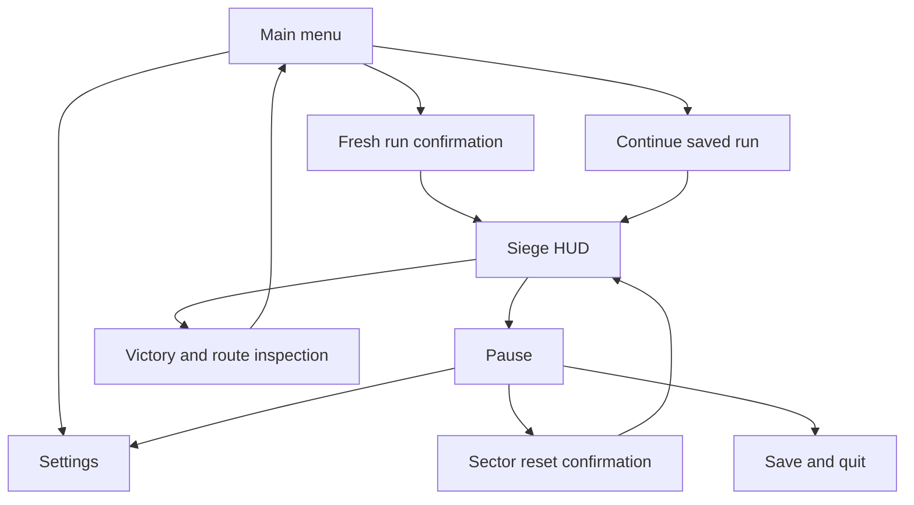

# Meat Shield art audio UX and accessibility

The proposed tone is photorealistic industrial horror with restrained administrative humor. The fortress is heavy, practical, and indifferent. Bodies gradually become infrastructure. Art and sound should make that shift legible while preserving quick decisions.

Follow the [procedural production pipeline](procedural-production.md): assemble and generate repeatable content primarily in Unreal, with Blender for source asset authoring and preparation. Recipes must preserve the authored gameplay constraints and be reproducible.

## Art direction and production

Use concrete, oxidized steel, wet stone, worn polymer, and mass-produced equipment. A small material library and modular architecture provide most variation. Warm deployment machinery and cool defensive sightlines can separate regions, but shape, pattern, and light placement must also carry the distinction.

Prioritize the first-person rifle, hands, one full body, damage and hardening transition, one representative wall kit, and the frontal emplacement for the slice. Photorealism is an art direction target, not a commitment to expensive camera effects or a particular rendering feature. Establish a quality floor on the nominated performance machine before adding high-detail dressing.

One canonical body silhouette must remain recognizable in every quality and gore setting. Frozen body geometry and its collision proxy are reviewed together. Dismemberment, fluid simulation, and damage-driven collision changes are outside the baseline. Blood decals, impact particles, and surface damage are cosmetic, pooled, and individually budgeted.

The hardening transition is short and visually practical: equipment locks, the pose becomes stable, and an understated material change signals support. Additional deaths in a full tile do not leave a new apparently solid protrusion. Show a brief material-full pattern near that location rather than repeatedly adding misleading bodies.

For each asset, the register records owner role, quantity, target gate, naming, dependencies, and acceptance. Production exports must include source ownership, license or creation record, scale, pivot, collision intent, LODs where applicable, and material references. The exact texture and triangle budgets are set from the M2 benchmark rather than guessed per asset here.

## Camera and effects

Use a centered, responsive first-person camera with configurable FOV. Keep recoil readable. Camera shake, head bob, motion blur, chromatic effects, and strong lens distortion must be separately reducible or disabled. No persistent blood overlay may hide a useful placement or mandatory telegraph. Hit feedback should communicate direction without long control lockouts.

Prototype with a simple camera first. Add final-intent treatment only after the placement and route are understandable. The game's brutality comes from context and physical consequence; repeated screen flashes are not required to convey it.

## Audio and music

Weapon fire needs distinct near, environmental, and distant components. Threat acquisition, telegraph, suppression, recovery, and permanent shutdown each have distinguishable cues paired with visual feedback. Body impact and hardening communicate when terrain becomes useful. Avoid a loud musical reset on each death.

Use one adaptive industrial music suite with three intensity layers and a final breach transition. Layers respond to siege progress and active threat pressure. Voices are optional short administrative notices delivered without exaggerated jokes; no dialogue tree or cinematic production is planned.

Provide master, music, effects, and voice volume controls. Subtitle authored voice and essential nonverbal cues, label direction or source when useful, and keep essential information available visually. Define the final loudness target with the audio contractor during M2 and verify intelligibility at reduced dynamic range.

## Screen and flow inventory

Main menu must handle no save, valid save, recovered backup, and incompatible save. Pause shows checkpoint, run classification, and save state. A failed save keeps the previous good save and offers retry or return to play. Sector reset describes exactly which progress will be removed and marks the result assisted.

The HUD shows health, ammunition, current objective, and optional active timer. Latest-body feedback lasts briefly and can be disabled. Objective labels use world landmarks and a compact indicator; do not require an always-on path line that solves placement. Results show time, deployments, ruleset, and uninterrupted, resumed, or assisted classification.

## Accessibility requirements

- Fully rebind keyboard, mouse, and controller actions; offer hold or toggle for sprint, crouch, and aim.
- Provide controller sensitivity, deadzone, inversion, and consistent focus navigation. Prompts update to the last active device.
- Scale HUD and subtitle text; support subtitle background opacity and speaker labels. Verify at 1080p and the smallest supported display configuration.
- Convey threat and material states through pattern, animation, text or icon, and sound; never color alone.
- Offer the camera controls above, a reduced-flash setting, and reduced gore without changing cover geometry or scoring eligibility.
- Pause on focus loss; prevent stuck fire, repeated interaction, and surprise input when returning from menus or respawn.
- Keep settings persistent independently of a run and provide reset-to-default per settings group.
- Externalize all player-facing strings. Use stable string IDs, avoid text baked into art, and test longer pseudo-localized labels before M4.

Accessibility options that alter presentation remain eligible for ordinary local records. Gameplay assists, if later added, require a new ruleset or assisted classification. Additional languages, voice recording, and specialized certification require an explicit scope and budget decision.
