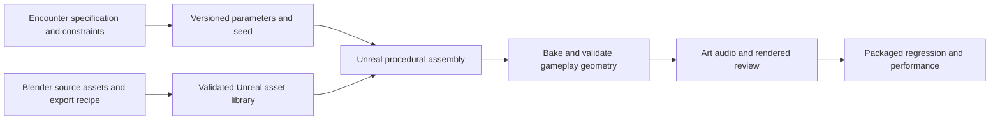

# Meat Shield procedural production pipeline

Use procedural production primarily in Unreal while preserving authored encounter intent. Blender supplies reusable source assets where modeling, sculpting, UVs, rigging, or animation need its tools. The full editor remains available for visual review and refinement; repeatable work belongs in versioned recipes.

## Content flow

A generated fortress must retain the designer's required cover gaps, height thresholds, threat arcs, control access, construction volumes, spawn protection, and recovery routes. Procedural placement can populate the kit and dressing inside those constraints. It must not silently produce a different puzzle on every retry.

## Responsibility by tool

| Work | Preferred production approach |
| --- | --- |
| Fortress wall floor ditch ledge and gate modules | Parameterized Unreal authoring with reusable meshes and materials |
| Repeated architecture props debris and surface variation | Constrained procedural assembly, stable seeds and exclusion volumes |
| Mesh construction and processing | Evaluate Unreal Geometry Script, then bake where static assets suit the target rendering path |
| Materials damage presentation and effects | Parameterized Unreal material and Niagara systems with explicit runtime budgets |
| Characters hero weapon custom shapes and rigs | Blender source authoring and scripted export, imported and validated in Unreal |
| Repeated source preparation | Blender Python or geometry-node recipes with recorded inputs and export presets |
| Camera animation lighting and final review | Appropriate Unreal animation rigging cinematic and rendering features, measured in the representative scene |
| Stable corpse construction | Gameplay subsystem's tested proxies and quotas; decorative generators never own useful collision |

Geometry Script can generate and process meshes through Blueprints and Python. Its dynamic mesh representation has different rendering and instancing support from static meshes, so evaluate baking and representative performance rather than assuming every dynamic output supports the desired renderer features. [Epic Geometry Script guide](https://dev.epicgames.com/documentation/en-us/unreal-engine/geometry-scripting-users-guide-in-unreal-engine).

## Recipe contract

Every generator records a stable recipe ID and version, seed, parameter schema, input asset IDs and revisions, required engine or Blender version, coordinate and unit convention, output ownership, bake mode, and validation profile. Separate gameplay-affecting parameters from cosmetic parameters and version rules when gameplay changes.

Generation must be idempotent: rerunning the same recipe either updates its owned outputs or reproduces them without duplicating actors and assets. Never replace hand-authored content or unrelated assets by broad name matching. Keep source recipes and required baked outputs available to a clean checkout through the selected binary workflow.

Prefer editor-time generation and baking for the authored baseline fortress. Runtime generation must justify its cost and remain deterministic for saved content. This direction does not add random maps, terrain excavation, destructive body physics, or new gameplay systems to the approved scope.

## Validation before implementation

Specify the expected output and invariants before writing a generator. Write failing tests for parameter validation, stable IDs, deterministic planning, ownership, and import/export transforms. Add real engine fixtures for geometry, materials, collision, and baking; do not infer those results from a mocked API.

For each representative recipe, demonstrate identical output IDs and layout for the same seed, no duplicate outputs on rerun, preserved authored exclusion volumes, valid supported collision, compatible save IDs, and the same intended one-to-three-body route. Visual randomness must not alter threat visibility or construction support.

Review generated output at low and final-intent quality, then run the relevant packaged regression and performance scenarios. A successful generation script is not proof that the encounter is readable, the assets are licensed, or the build is ready to release.
